# *SOLO* Nivel 1

## Clase Descarga

- Creamos la clase Descarga heredando Thread y le damos atributos

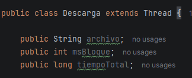

- Creamos un constructor de Descarga que recibe el archivo como parametro

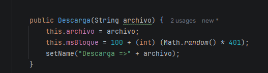

- Creamos el run (ya comentado)

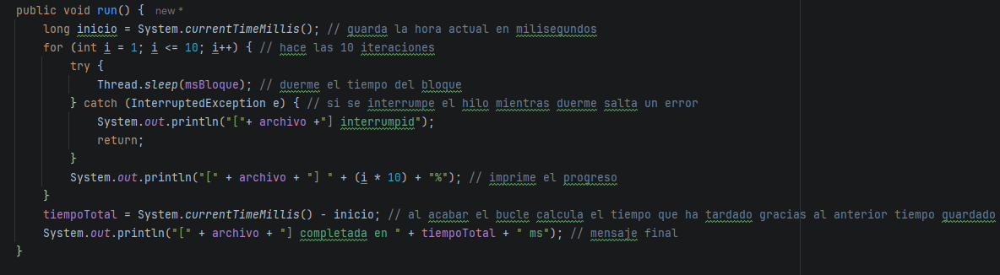

- Para acabar con la clase Descarga hacemos un getter del Tiempo total

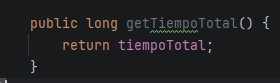

## Clase GestorDescargas

- Creamos la clase GestorDescargas y los hilos 

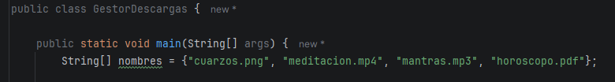

- Guardamos el tiempo actual y creamos un array de 4 espacios. Creamos 4 descargas con el nombre de cada hilo

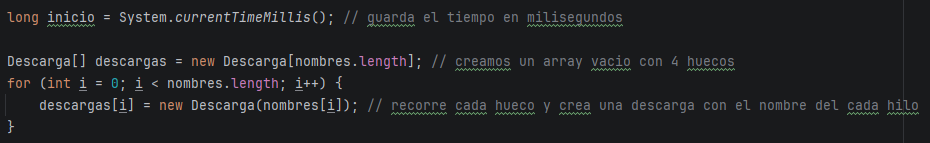

- Arrancamos todas las descargas y bloqueamos el main hasta que terminen 

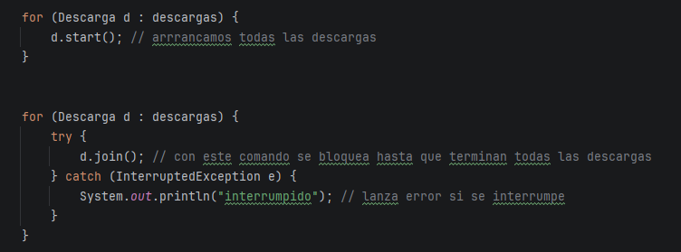

- Calculamos el tiempo total y creamos una variable para obtener la suma total de todos los tiempos 

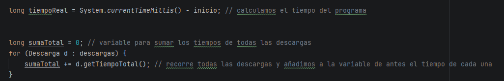

- Printeamos la informacion que pide la tarea

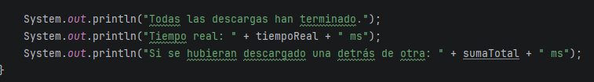

## TABLA

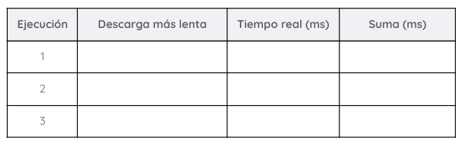

1 -- 4639ms -- 4641ms -- 14995ms
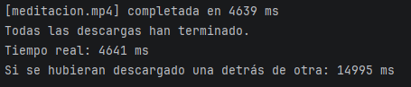

2 -- 4578ms -- 4580ms -- 11284ms
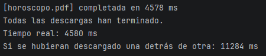

3 -- 4827ms -- 4829ms -- 14129ms
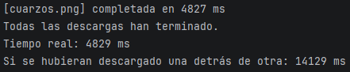

## PREGUNTAS

**¿Por qué el tiempo real es mucho menor que la suma?**
Porque las cuatro descargas se ejecutan a la vez

**¿Qué pasa si hacéis start() y join() dentro del mismo bucle?**
Que el main arranca un hilo y espera a que termine antes de arrancar el
siguiente

## uso de IA
Busqué en Claude que comando podía utilizar para bloquear el programa hasta que terminen todas las descargas (join)